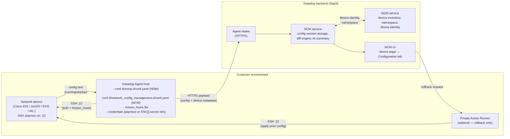
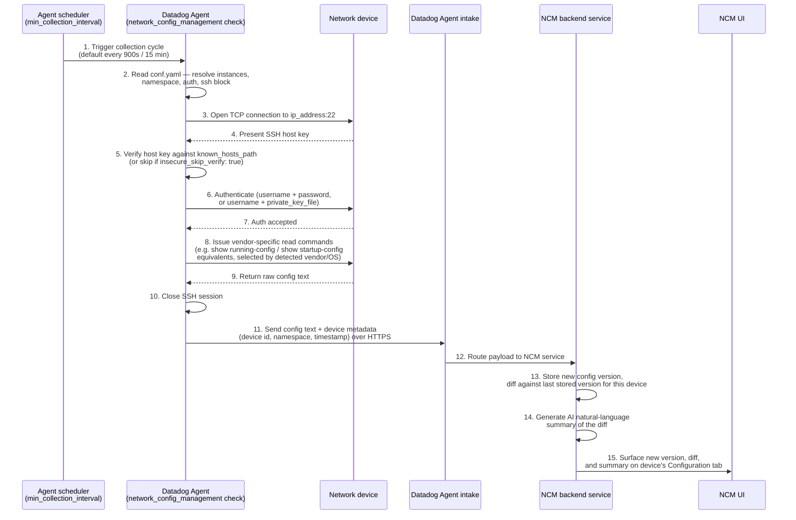

# NCM architecture — components and collection flow

Two diagrams: **where each component lives**, and **the step-by-step flow**
from the Agent reaching out to a device to the configuration landing in the
Datadog backend. Both are [Mermaid](https://mermaid.js.org/) diagrams, which
GitHub renders natively in markdown — no separate image file to keep in sync.

The sequence-diagram steps below are a reconstruction from the [public NCM
docs](https://docs.datadoghq.com/network_monitoring/devices/config_management/)
and general Datadog Agent architecture, not Datadog's internal implementation
spec — steps 1-9 (device-facing) are precise, since they're directly
determined by `conf.yaml` and standard SSH behavior; steps 10-13
(backend-internal: storage, diffing, AI summary) are necessarily described at
a higher level, since the backend's internals aren't publicly documented in
full.

## 1. Components and where they live

## 2. Step-by-step collection flow

## 3. Rollback (on-demand, not part of the regular collection cycle)

Rollback is a separate, user-initiated flow, not something that happens on
the `min_collection_interval` schedule:

1. A user selects a prior configuration version in the NCM UI and requests rollback.
2. The backend routes the request through a **Private Action Runner (PAR)** —
   a customer-hosted component Datadog uses for actions that need to reach
   back into the customer's network to make a change, as opposed to the
   read-only collection flow above.
3. The PAR connects to the device over SSH and applies the selected prior
   configuration.

Because rollback writes to the device, the account used for it needs
write/commit-capable privileges — see
[`least-privilege-service-account/`](least-privilege-service-account/) for
how to scope that deliberately rather than by default.

## Why collection is read-only but rollback isn't

It's worth internalizing the asymmetry these diagrams show: every step in
the regular collection cycle (steps 3-10 above) is read-only — `show`-equivalent
commands, no device state changes. Rollback is the only operation in the
whole NCM feature set that writes to a device, and it only happens on
request, through a different path (the PAR), not through the Agent's regular
polling cycle. This is why a read-only service account is sufficient for
backup/diff/AI-summary, and why rollback access should be a deliberate,
separately-reviewed grant.
