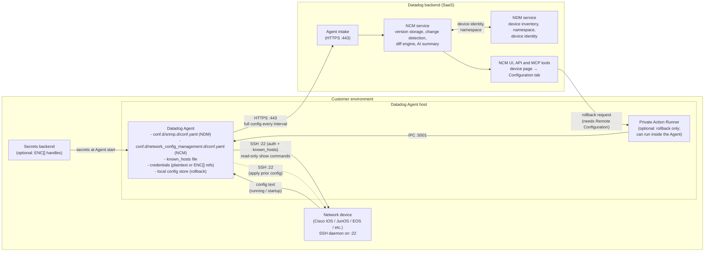

# NCM architecture — components and collection flow

Two diagrams: **where each component lives**, and **the step-by-step flow**
from the Agent reaching out to a device to the configuration landing in the
Datadog backend. Both are [Mermaid](https://mermaid.js.org/) diagrams, which
GitHub renders natively in markdown — no separate image file to keep in sync.

The sequence-diagram steps below are a reconstruction from the [public NCM
docs](https://docs.datadoghq.com/network_monitoring/devices/config_management/)
and general Datadog Agent architecture, not Datadog's internal implementation
spec — steps 1-9 (device-facing) are precise, since they're directly
determined by `conf.yaml` and standard SSH behavior; steps 10-13
(backend-internal: storage, diffing, AI summary) are necessarily described at
a higher level, since the backend's internals aren't publicly documented in
full.

## 1. Components and where they live



A rendered PNG of this diagram is in [`images/ncm-architecture-components.png`](images/ncm-architecture-components.png) for use outside GitHub (slides, docs).

**Two things this diagram makes explicit:**

- **Collection does not depend on Remote Configuration or the Private Action Runner.** It is an ordinary Agent check. If Remote Configuration or the PAR is disabled, config backup, diff and AI summaries keep working; only rollback stops.
- **The Agent sends the full configuration on every collection cycle.** It does not compare hashes locally. Change detection and diffing happen in the Datadog backend, which is why a new version only appears in the UI when something actually changed.

## 2. Step-by-step collection flow

```mermaid
sequenceDiagram
    participant Sched as Agent scheduler<br/>(min_collection_interval)
    participant Agent as Datadog Agent<br/>(network_config_management check)
    participant Device as Network device
    participant Intake as Datadog Agent intake
    participant NCM as NCM backend service
    participant UI as NCM UI

    Sched->>Agent: 1. Trigger collection cycle<br/>(default every 900s / 15 min)
    Agent->>Agent: 2. Read conf.yaml — resolve instances,<br/>namespace, auth, ssh block
    Agent->>Device: 3. Open TCP connection to ip_address:22
    Device-->>Agent: 4. Present SSH host key
    Agent->>Agent: 5. Verify host key against known_hosts_path<br/>(or skip if insecure_skip_verify: true)
    Agent->>Device: 6. Authenticate (username + password,<br/>or username + private_key_file)
    Device-->>Agent: 7. Auth accepted
    Agent->>Device: 8. Issue vendor-specific read commands<br/>(e.g. show running-config / show startup-config<br/>equivalents, selected by detected vendor/OS)
    Device-->>Agent: 9. Return raw config text
    Agent->>Agent: 10. Close SSH session
    Agent->>Intake: 11. Send the full config text + device metadata<br/>(device id, namespace, timestamp) over HTTPS,<br/>every cycle, changed or not
    Intake->>NCM: 12. Route payload to NCM service
    NCM->>NCM: 13. Compare with the last stored version;<br/>store a new version and diff only if it changed
    NCM->>NCM: 14. Generate AI natural-language<br/>summary of the diff
    NCM->>UI: 15. Surface new version, diff,<br/>and summary on device's Configuration tab
```

## 3. Rollback (on-demand, not part of the regular collection cycle)

Rollback is a separate, user-initiated flow, not something that happens on
the `min_collection_interval` schedule:

1. A user selects a prior configuration version in the NCM UI and requests rollback.
2. The backend sends the request to a **Private Action Runner (PAR)** in the
   customer network, delivered through Remote Configuration. The PAR can run
   inside the Agent itself (Agent 7.81+) or on a separate host that can
   reach the Agent.
3. The PAR hands the request to the Agent over the Agent's local IPC port
   (5001 by default).
4. The **Agent** applies the selected prior configuration to the device over
   the same SSH path it uses for collection, using the copies it keeps in its
   local config store.

```mermaid
sequenceDiagram
    participant UI as NCM UI
    participant PAR as Private Action Runner
    participant Agent as Datadog Agent<br/>(local config store)
    participant Device as Network device

    UI->>PAR: 1. Rollback request (via Remote Configuration)
    PAR->>Agent: 2. Hand off over IPC :5001
    Agent->>Device: 3. SSH :22, apply the chosen prior config
    Device-->>Agent: 4. Result
    Agent-->>UI: 5. Next collection shows the new running config
```

Rollback needs Agent 7.83.0+, `network_devices.config_management.rollback.enabled: true`
in `datadog.yaml`, Remote Configuration, a PAR with the rollback action on its
allowlist, and a device account with write rights. See
[`rollback/`](rollback/) for the configuration.

Because rollback writes to the device, the account used for it needs
write/commit-capable privileges — see
[`least-privilege-service-account/`](least-privilege-service-account/) for
how to scope that deliberately rather than by default.

## Why collection is read-only but rollback isn't

It's worth internalizing the asymmetry these diagrams show: every step in
the regular collection cycle (steps 3-10 above) is read-only — `show`-equivalent
commands, no device state changes. Rollback is the only operation in the
whole NCM feature set that writes to a device, and it only happens on
request, through a different trigger path (UI → PAR → Agent), not through
the Agent's regular polling cycle. This is why a read-only service account is sufficient for
backup/diff/AI-summary, and why rollback access should be a deliberate,
separately-reviewed grant.
