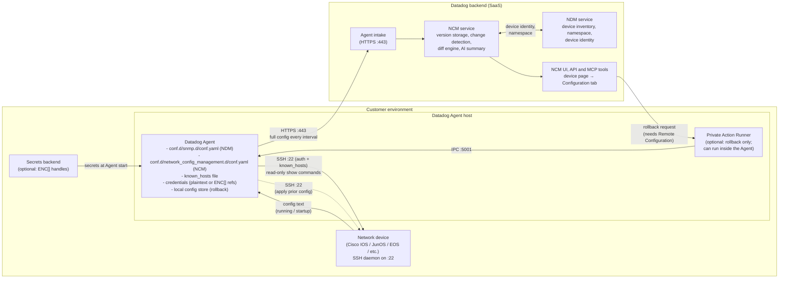

# Datadog NCM Configuration Guide

> Step-by-step companion to the samples in this directory. All IPs are RFC 5737 documentation addresses; all passwords are placeholders.

*Last updated: Nov 5, 2026*

## What this guide covers

This guide sets up Datadog Network Configuration Management (NCM) from zero to a working config backup, then adds rollback. Every step says what to do, why it matters and what each YAML line means. No networking background is assumed.

**What NCM does, in one paragraph.** Your switches, routers and firewalls each hold a text file of settings called a *configuration*. Every 15 minutes, the Datadog Agent logs in to each device, reads that configuration and sends a full copy to Datadog, whether or not anything changed. Datadog works out whether it changed. Datadog keeps every version for up to 1 year, shows what changed between versions, writes a plain-English summary of each change and can put an older version back on the device (rollback).



*Figure 1: NCM components and where they live. Solid lines are the regular collection path; the dotted line is rollback. Source:* [*ARCHITECTURE.md*](ARCHITECTURE.md)*. A PNG of this diagram for slides and documents is in* [*images/ncm-architecture-components.png*](images/ncm-architecture-components.png)*.*

Collection: the Agent gets passwords (from the file or a vault), logs in to each device over SSH, reads the config and sends it to Datadog over HTTPS. Rollback: Datadog sends the request to the Private Action Runner, which hands it to the Agent, which applies the old config over the same SSH path.

**How to use this guide.**

1. Read *Key terms* once, so the words used later make sense.
2. Do *Before you start*, *Step 1* and *Step 2*. Everyone needs these.
3. Pick **one** way to log in to devices: Option A (password), Option B (SSH key) or Option C (secrets manager). Option C is the right choice for production.
4. Add Option D if you have many devices, and Option E only if a device refuses to connect.
5. Finish with *Step 4: Deploy, restart and verify*. Set up *Rollback* last, once collection works.

All IP addresses in this guide (198.51.100.x) are documentation examples. Replace every one with your real device addresses. The examples follow the [ncm-config-samples](README.md) library and the [official NCM docs](https://docs.datadoghq.com/network_monitoring/devices/config_management/).

## Key terms

These are the words the rest of the guide uses. Each one is explained with an everyday comparison.

| **Term** | **What it means** | **Everyday comparison** |
|---|---|---|
| Network device | A switch, router, firewall or load balancer, such as Cisco, Juniper, Arista or Fortinet. | The machines that move traffic around your network. |
| Configuration (config) | The text file of settings that tells a device how to behave. | A recipe the device follows. |
| Running config | The settings the device is using right now. | The recipe on the counter. |
| Startup config | The saved settings the device loads when it reboots. Not every vendor has one. | The recipe filed in the book. |
| IP address | The number that identifies a device on the network, for example 198.51.100.10. | A street address. |
| SSH | Secure Shell. The encrypted way to log in to a device's command line over the network. It uses port 22. | A locked phone line to the device. |
| Port 22 | The network "door" SSH uses. Firewalls must allow it from the Agent to each device. | The door number on the building. |
| Datadog Agent | Datadog's software on one of your servers. It does the logging in and reading for NCM. | The courier who collects the recipe. |
| NDM | Network Device Monitoring. Datadog's device monitoring over SNMP. NCM is built on top of it. | The address book NCM uses to know which devices exist. |
| Service account | A login made for a program, not a person, for example `ncm-readonly`. | A key cut for the courier only. |
| Host key | A unique digital fingerprint each device shows when you connect by SSH. | The device's ID card. |
| known_hosts file | A list of trusted host keys. The Agent checks each device's fingerprint against it before logging in. | A guest list at the door. |
| SSH private key | A file that proves identity instead of a password. Its matching *public* key is installed on the device. | A physical key; the device has the lock. |
| YAML | The plain-text format Datadog config files use. Indentation (spaces) carries meaning. | A form where the indentation is part of the answer. |
| Secret / secrets manager | A password or key stored in a protected vault (HashiCorp Vault, AWS Secrets Manager, etc.) instead of in a file. | A safe instead of a sticky note. |
| `ENC[...]` handle | A placeholder in a config file that tells the Agent "fetch this value from the secrets manager." | A claim ticket for an item in the safe. |
| Private Action Runner (PAR) | A small Datadog component in your network that carries out actions Datadog requests. Rollback needs it. | A trusted on-site helper. |

**YAML rule that causes most failures:** indent with spaces, never tabs. Items at the same level must line up exactly. A list item starts with `- ` (dash and space).

## Before you start

Tick every box below before you touch the NCM config. Most "NCM is broken" cases are really one of these missing.

- **The device already shows up in Datadog NDM.** Open [Network Devices](https://app.datadoghq.com/devices) and find it. NCM attaches configs to devices NDM already knows. If it isn't there, set up the SNMP integration first.
- **The device type is supported.** NCM supports Arista EOS, Aruba AOS-CX and AOS-W, Cisco IOS and NX-OS, Dell OS10 (Dell OS9 is not supported), F5 TMOS, FortiGate FortiOS, Juniper JunOS and Palo Alto PAN-OS ([current list](https://docs.datadoghq.com/network_monitoring/devices/config_management/#supported-device-profiles)).
- **The Agent is new enough.** Each vendor has a minimum Agent version, from 7.73.0 (Cisco IOS) to 7.77.0 (Arista, Dell, FortiGate). Rollback needs **7.83.0 or later**. Check with `datadog-agent version`.
- **The Agent server can reach each device on port 22.** Test from the Agent server: `nc -zv 198.51.100.10 22`. "succeeded" or "open" means yes. A timeout means a firewall is blocking it; ask your network team to allow TCP 22 from the Agent server to the devices.
- **You can log in by SSH yourself.** From the Agent server, run `ssh ncm-readonly@198.51.100.10` with the account from Step 1. If you can't log in by hand, the Agent can't either.
- **You know your Datadog namespace.** NDM groups devices into namespaces; the default is `default`. NCM must use the same one, or configs won't attach to the device.

**Where the NCM config file lives.** Every option in this guide edits the same file:

```text
Linux:   /etc/datadog-agent/conf.d/network_config_management.d/conf.yaml
Windows: C:\ProgramData\Datadog\conf.d\network_config_management.d\conf.yaml
```

Create the folder if it doesn't exist. Some settings (secrets, rollback) also go in the Agent's main file, `/etc/datadog-agent/datadog.yaml`.

## Step 1: Create the device login (service account)

NCM needs its own login on every device. Use a dedicated account, for example `ncm-readonly`, not a person's login. That way you can see in device logs exactly what NCM did, and change its password without locking anyone out.

**Choose the access level.**

| **You want** | **Access the account needs** | **Why** |
|---|---|---|
| Config backup, diff and AI summaries only | Read-only ("show" commands only) | NCM only runs read commands such as `show running-config`. It never changes the device during collection. |
| Backup **plus rollback** | Read **and** write (enter config mode, apply and save) | Rollback puts an old config back on the device, which is a change. Treat this as a separate, approved grant. |

**Steps.**

1. Ask your network team to create the account on each device, or centrally in AAA/TACACS+/RADIUS (the systems many companies use to control device logins).

2. Give it read-only access to start. Add write access later only if you set up rollback.

3. Make sure it can run the read command for your vendor:

| **Vendor** | **Command NCM runs** |
|---|---|
| Cisco IOS / NX-OS, Aruba | `show running-config`, `show startup-config` |
| Arista EOS | `show running-config \| no-more \| exclude ! Time:` |
| Juniper JunOS | `show configuration \| display omit` |
| FortiGate | `show full-configuration` |
| Palo Alto | `show config running` |
| Dell OS10 | `show running-configuration` |
| F5 TMOS | `cat /config/partitions/*/bigip*.conf` |

4. Test it on **one** device first. Log in by hand (`ssh ncm-readonly@<device IP>`) and run the command above. You should see the full config.

5. Only then roll the account out to all devices.

**Watch out:** an account without enough rights doesn't show an error in Datadog. It just collects nothing, which looks like an SSH problem. The hand test in item 4 is your proof that the rights are right.

## Step 2: Set up the known_hosts file (trusting the device)

**What it is.** When the Agent connects to a device, the device shows its *host key*, a unique digital fingerprint. The `known_hosts` file is the Agent's list of fingerprints it trusts. If the fingerprint matches, the Agent logs in. If not, it refuses.

**Why it matters.** Without this check, anything that answers at the device's IP address could pretend to be the device and capture NCM's password. This is called a *man-in-the-middle* attack. The check also catches a device that was swapped out without anyone telling you.

**What it is not.** The Agent does not create or fill this file for you. An empty or missing file makes every connection fail.

**Steps (Linux).**

1. Create the folder and file:

```bash
sudo mkdir -p /etc/datadog-agent/.ssh
sudo touch /etc/datadog-agent/.ssh/known_hosts
```

2. Fetch each device's fingerprint and add it. Repeat for every device IP:

```bash
ssh-keyscan -H 198.51.100.10 | sudo tee -a /etc/datadog-agent/.ssh/known_hosts
```

`ssh-keyscan` asks the device for its key. `-H` scrambles (hashes) the IP in the file, so a leaked file doesn't reveal your device list. `tee -a` appends it to the file.

3. **Confirm the fingerprint is real.** `ssh-keyscan` trusts whatever answers. Compare the fingerprint with the device's own console, your vendor tool or a change record. To print the fingerprint you saved: `ssh-keygen -lf /etc/datadog-agent/.ssh/known_hosts`. On a Cisco device, `show ip ssh` or `show crypto key mypubkey rsa` shows the device's side.

4. Let the Agent read the file:

```bash
sudo chown -R dd-agent:dd-agent /etc/datadog-agent/.ssh
sudo chmod 700 /etc/datadog-agent/.ssh
sudo chmod 644 /etc/datadog-agent/.ssh/known_hosts
```

`dd-agent` is the user the Agent runs as on Linux.

5. If a device uses a port other than 22, scan it with `ssh-keyscan -H -p 2222 198.51.100.10`.

**The YAML lines this step feeds.**

```yaml
  ssh:
    known_hosts_path: /etc/datadog-agent/.ssh/known_hosts
    insecure_skip_verify: false
```

- `known_hosts_path` tells the Agent where the trusted-fingerprint list is. It is required unless you turn verification off.
- `insecure_skip_verify` decides whether the fingerprint check happens. `false` (the default) means **check it**. `true` means **trust any device that answers**.

**When is** `insecure_skip_verify: true` **OK?** Only in a lab, briefly, while you build the `known_hosts` file. Never in production: it removes the protection described above. If you use it to get started, write a reminder to switch it back to `false`.

**Keep it current.** When a device is replaced or reinstalled, its fingerprint changes and NCM stops collecting from it. Remove the old line (`ssh-keygen -R 198.51.100.10 -f /etc/datadog-agent/.ssh/known_hosts`), then repeat steps 2 and 3.

## Step 3: Understand the conf.yaml file

The file has two parts. `init_config` holds settings shared by **all** devices. `instances` is the **list of devices**, one entry each. Every option later in this guide changes only a few lines of this same shape.

```yaml
init_config:                      # Part 1: shared settings for every device
  namespace: default              # must match the device's NDM namespace
  min_collection_interval: 900    # seconds between collections (900 = 15 min)
  ssh:                            # SSH settings for all devices
    timeout: 30                   # seconds to wait for a connection
    known_hosts_path: /etc/datadog-agent/.ssh/known_hosts
    insecure_skip_verify: false   # false = check the device fingerprint

instances:                        # Part 2: the device list (same indent as init_config)
  - ip_address: 198.51.100.10     # "- " starts one device entry
    auth:                         # how to log in to this device
      username: ncm-readonly
      password: "Example-Password-123"
```

**What each line does.**

| **Line** | **Required?** | **Purpose** | **Notes** |
|---|---|---|---|
| `init_config:` | Yes | Opens the shared settings. | Starts at the left edge, no spaces. |
| `namespace` | No (default `default`) | Tells Datadog which NDM device group these devices belong to. | Must match the namespace in your SNMP (NDM) config, or the config won't attach to the device. |
| `min_collection_interval` | No (default 900) | How often, in seconds, the Agent collects configs. | 900 = every 15 minutes. Lower means more logins on the device and more upload traffic, because the full config is sent every time. |
| `ssh:` | No | Opens the SSH settings that apply to every device. | Indented 2 spaces under `init_config`. |
| `timeout` | No (default 30) | Longest time, in seconds, the Agent waits to connect before giving up. | Raise it for slow or far-away links. |
| `known_hosts_path` | Yes, unless skip verify is on | Where the trusted-fingerprint list lives (Step 2). | The file must exist and contain the device's key. |
| `insecure_skip_verify` | No (default `false`) | Turns the fingerprint check off when `true`. | Lab only. Keep `false` in production. |
| `instances:` | Yes | Opens the device list. | Starts at the left edge, like `init_config`. **Never** put it inside `ssh:`. |
| `- ip_address` | Yes | The device's management IP address. The dash starts a new device. | One `- ip_address` block per device. |
| `auth:` | Yes | Opens the login details for that device. | Indented under the device entry. |
| `username` | Yes | The service account name from Step 1. |  |
| `password` | Yes, unless you use a key | The account's password. | Option A uses it directly; Option C fetches it from a vault. |
| `private_key_file` | Yes, unless you use a password | Path to an SSH private key file. | Option B. If both are set, Datadog tries the key first and uses the password as a fallback. |

**The two mistakes behind most support tickets.**

1. `instances:` indented inside the `ssh:` block. It must sit at the left edge.
2. A device written without the leading `-` . `instances` must be a list.

Both give vague errors like "no valid instances". If you see one, check the indentation first. An online YAML checker helps, but never paste a file with real passwords into one.

## Option A: Password in the YAML file (simplest, lab and testing)

The password is typed straight into `conf.yaml`. It's the quickest way to prove NCM works. Anyone who can read the file can read the password, so move to Option C before production.

**Steps.**

1. Open (or create) the config file:

```bash
sudo mkdir -p /etc/datadog-agent/conf.d/network_config_management.d
sudo nano /etc/datadog-agent/conf.d/network_config_management.d/conf.yaml
```

2. Paste this, then change the three marked lines:

```yaml
init_config:
  namespace: default
  min_collection_interval: 900
  ssh:
    timeout: 30
    known_hosts_path: /etc/datadog-agent/.ssh/known_hosts
    insecure_skip_verify: false

instances:
  - ip_address: 198.51.100.10            # CHANGE: your device IP
    auth:
      username: ncm-readonly             # CHANGE: your service account
      password: "Example-Password-123"   # CHANGE: its password
```

Put the password in double quotes. Characters like `#`, `:` or `!` would otherwise confuse YAML.

3. Lock the file so only the Agent can read it:

```bash
sudo chown dd-agent:dd-agent /etc/datadog-agent/conf.d/network_config_management.d/conf.yaml
sudo chmod 640 /etc/datadog-agent/conf.d/network_config_management.d/conf.yaml
```

4. Don't commit this file to Git or share it in tickets or chat.

5. Go to *Step 4: Deploy, restart and verify*.

## Option B: SSH private key (no password stored)

Instead of a password, the Agent proves who it is with a key file. You create a key *pair*: the **private key** stays on the Agent server, the **public key** goes on each device. No password is written anywhere, and many security teams prefer this.

**Steps.**

1. Create the key pair on the Agent server:

```bash
sudo -u dd-agent ssh-keygen -t ed25519 -f /etc/datadog-agent/.ssh/ncm_ed25519 -N "" -C "datadog-ncm"
```

`-t ed25519` picks a modern key type. `-f` sets where it's saved. `-N ""` means no passphrase, because the Agent can't type one. Older devices may not support ed25519; use `-t rsa -b 4096` instead.

2. Install the **public** key on each device for the `ncm-readonly` account. Send your network team the contents of `/etc/datadog-agent/.ssh/ncm_ed25519.pub` (the `.pub` file only, never the other one). They add it with the vendor's command, for example `ip ssh pubkey-chain` on Cisco IOS or `set system login user ncm-readonly authentication ssh-ed25519` on Juniper.

3. Protect the private key. SSH refuses keys other users can read:

```bash
sudo chown dd-agent:dd-agent /etc/datadog-agent/.ssh/ncm_ed25519
sudo chmod 600 /etc/datadog-agent/.ssh/ncm_ed25519
```

4. Test it by hand as the Agent user:

```bash
sudo -u dd-agent ssh -i /etc/datadog-agent/.ssh/ncm_ed25519 \
  -o UserKnownHostsFile=/etc/datadog-agent/.ssh/known_hosts ncm-readonly@198.51.100.11
```

5. Write the config. Only the `auth` block differs from Option A:

```yaml
instances:
  - ip_address: 198.51.100.11
    auth:
      username: ncm-readonly
      private_key_file: /etc/datadog-agent/.ssh/ncm_ed25519   # path to the key, not the key text
      # password:   leave unset when using a key
```

6. Go to *Step 4: Deploy, restart and verify*.

**Good to know.** `private_key_file` takes a **file path**, not the key itself. If you set both a key and a password, Datadog tries the key first and falls back to the password. Set only one, so you always know which login worked.

## Option C: Secrets management with ENC[] (recommended for production)

The password lives in a secrets vault, not in `conf.yaml`. The config file holds only a placeholder such as `ENC[ncm_password]`. When the Agent starts, it asks the vault for the real value and keeps it in memory. The value is never written to disk or sent to Datadog. The config file is then safe to store in Git.

**How it fits together.**

1. You store the password in a vault under a name (the *handle*), for example `ncm_password`.
2. You tell the Agent which vault to use, in `datadog.yaml`. This is the *secret backend*.
3. In `conf.yaml` you write `password: ENC[ncm_password]` instead of the password.
4. At startup the Agent swaps each `ENC[...]` for the real value from the vault.

This is a general Agent feature. It works for every integration, not only NCM. Needs Agent 7.70+ for the built-in vault types below; older Agents use C4.

### C1. Local secrets file (simplest; good first step)

The secrets sit in one protected file on the Agent server. Better than Option A because `conf.yaml` stays clean and can be shared.

1. Create the secrets file:

```bash
sudo mkdir -p /etc/datadog-agent/secrets
sudo nano /etc/datadog-agent/secrets/ncm.yaml
```

```yaml
ncm_username: ncm-readonly
ncm_password: "Example-Password-123"
```

One level only: `name: value`, no nesting.

2. Lock it so only the Agent can read it:

```bash
sudo chown -R dd-agent:dd-agent /etc/datadog-agent/secrets
sudo chmod 700 /etc/datadog-agent/secrets
sudo chmod 400 /etc/datadog-agent/secrets/ncm.yaml
```

3. Tell the Agent to use it. Add to `/etc/datadog-agent/datadog.yaml`:

```yaml
secret_backend_type: file.yaml          # the kind of vault
secret_backend_config:
  file_path: /etc/datadog-agent/secrets/ncm.yaml   # where it is
```

4. Use the handles in `conf.yaml`:

```yaml
    auth:
      username: ENC[ncm_username]
      password: ENC[ncm_password]
```

### C2. AWS Secrets Manager

1. In AWS, create a secret named `ncm/prod` holding a JSON pair:

```json
{ "username": "ncm-readonly", "password": "Example-Password-123" }
```

2. Let the Agent server read it. Attach an IAM role (instance profile) to the server with `secretsmanager:GetSecretValue` on that secret. Datadog recommends instance profiles because no AWS keys are stored on the server.

3. Add to `datadog.yaml`:

```yaml
secret_backend_type: aws.secrets
secret_backend_config:
  aws_session:
    aws_region: us-east-1   # CHANGE: your region
```

4. In `conf.yaml`, the handle is `secret name;key name`:

```yaml
      username: ENC[ncm/prod;username]
      password: ENC[ncm/prod;password]
```

### C3. HashiCorp Vault

1. Store the credentials at a Vault path, for example `secret/ncm/prod`, with keys `username` and `password`.

2. Give the Agent a way to log in to Vault (AWS IAM, Kubernetes, AppRole or a token) and a policy that can read that path.

3. Add to `datadog.yaml`:

```yaml
secret_backend_type: hashicorp.vault
secret_backend_config:
  vault_address: https://vault.example.net   # CHANGE
  vault_session:
    vault_auth_type: aws                     # or kubernetes; AppRole uses vault_role_id + vault_secret_id
    vault_aws_role: datadog-agent            # CHANGE: your Vault role
```

4. In `conf.yaml`, the handle is `path;key`:

```yaml
      password: ENC[/secret/ncm/prod;password]
```

Azure Key Vault, GCP Secret Manager, Kubernetes secrets and Windows registry are also built in. See [Datadog secrets management](https://docs.datadoghq.com/agent/configuration/secrets-management/) for their settings.

### C4. Your own script (any other vault, or Agent older than 7.70)

You write a small program. The Agent sends it the handle names; it returns the values.

1. Create `/etc/datadog-agent/secret_helper.py`. This example reads the same local file as C1; replace the lookup with your vault's API. It needs the PyYAML package (`pip install pyyaml`):

```python
#!/usr/bin/env python3
import json, sys, yaml
request = json.load(sys.stdin)            # {"version": "1.0", "secrets": ["ncm_password"]}
store = yaml.safe_load(open("/etc/datadog-agent/secrets/ncm.yaml"))
reply = {}
for handle in request["secrets"]:
    if handle in store:
        reply[handle] = {"value": str(store[handle]), "error": None}
    else:
        reply[handle] = {"value": None, "error": "not found"}
print(json.dumps(reply))
```

2. Set strict permissions. The Agent refuses to run it otherwise:

```bash
sudo chown dd-agent:dd-agent /etc/datadog-agent/secret_helper.py
sudo chmod 700 /etc/datadog-agent/secret_helper.py
```

The script must belong to `dd-agent`, and no one else may read, write or run it.

3. Add to `datadog.yaml`: `secret_backend_command: /etc/datadog-agent/secret_helper.py`

4. Test it exactly as the Agent will:

```bash
sudo -u dd-agent bash -c "echo '{\"version\": \"1.0\", \"secrets\": [\"ncm_password\"]}' | /etc/datadog-agent/secret_helper.py"
```

Never print secret values to the error output (stderr); the Agent logs it.

### Check the vault connection before relying on it

1. Restart the Agent: `sudo systemctl restart datadog-agent`
2. Run `sudo -u dd-agent datadog-agent secret`. It checks permissions and lists every handle it resolved and which file it came from. Each NCM handle should show `from network_config_management.d/conf.yaml`.
3. If a handle fails, the Agent **skips that whole device**. A device missing in Step 4 checks usually means a secrets problem, not a password problem.

### SSH keys with secrets

`private_key_file` needs a **file path**. If you write `private_key_file: ENC[...]`, the vault must return a path, not the key text. Simpler: place the key file with your deployment tool (Ansible, Vault Agent, etc.) as in Option B, reference the path directly, and use `ENC[]` only for passwords.

## Option D: Many devices and mixed vendors

NCM has no autodiscovery: it only collects from devices you list. Each device is one `- ip_address` entry under `instances`. You don't need to name the vendor; the Agent detects it and picks the right commands.

**Several devices by hand (up to about 50).**

```yaml
instances:
  - ip_address: 198.51.100.20        # Cisco IOS core switch
    auth:
      username: ncm-readonly
      password: ENC[ncm_password]
  - ip_address: 198.51.100.21        # Juniper edge router
    auth:
      username: ncm-readonly
      password: ENC[ncm_password]
  - ip_address: 198.51.100.22        # Arista leaf, key login
    auth:
      username: ncm-readonly
      private_key_file: /etc/datadog-agent/.ssh/ncm_ed25519
```

Every device also needs its line in `known_hosts` (Step 2). Each device can use a different login method.

**Generate the list from your inventory (about 50+ devices).** Hand-editing a long list drifts out of date: retired devices stay, new ones get missed. Instead, build `conf.yaml` from the system that already tracks your devices. The [scale-templating sample](scale-templating) shows how.

1. Export your devices to a CSV (from a spreadsheet, NetBox, a CMDB or Ansible inventory):

```bash
ip_address,username,auth_type,secret_ref
198.51.100.40,ncm-readonly,password,ncm_password
198.51.100.41,ncm-readonly,password,ncm/prod;password
198.51.100.42,ncm-readonly,key,ncm_key_path
```

`auth_type` is `password` or `key`. `secret_ref` is the **name** of the secret (the `ENC[]` handle), never the real password.

2. Download `generate_conf.py` from the sample and run it:

```bash
python3 generate_conf.py devices.csv > conf.yaml
```

It writes the shared `init_config` block, then one device entry per CSV row, wrapping each `secret_ref` as `ENC[...]`.

3. Check the output, then copy it into place (Step 4).

4. Rerun the script whenever the inventory changes. Ideally a CI job does this automatically.

**Limits of the sample script.** For rows marked `key`, it writes `private_key_file: ENC[...]`, so your vault must return a key path (see Option C). Anything other than `key` is treated as a password, including typos. It doesn't check IPs or remove duplicate rows. All devices share the same interval, namespace and SSH settings.

## Option E: Custom SSH algorithms (older or locked-down devices)

Use this only if a device refuses the connection with errors like "no common algorithm" or "no supported methods remain". It means the Agent and the device couldn't agree on how to encrypt the session. This is common on old devices (which only know old methods) and hardened ones (which allow only a few).

**What the three settings mean.**

| **Setting** | **What it chooses** | **Plain meaning** |
|---|---|---|
| `ciphers` | How the session data is encrypted. | The lock on the phone line. |
| `key_exchanges` | How both sides agree on a secret session key. | The handshake to pick that lock. |
| `host_key_algorithms` | Which type of device fingerprint is accepted. | Which kind of ID card is accepted. |

**Steps.**

1. Confirm the basics first: port 22 is open and a manual `ssh` login works. This setting fixes only the handshake, not passwords or firewalls.

2. See what the device offers. From the Agent server:

```bash
ssh -vv ncm-readonly@198.51.100.10 2>&1 | grep -iE "kex|cipher|host key|no matching"
```

The "no matching" line names what's missing and lists what the device supports ("Their offer: ...").

3. Add the matching names under `ssh:` in `init_config`:

```yaml
init_config:
  ssh:
    timeout: 30
    known_hosts_path: /etc/datadog-agent/.ssh/known_hosts
    insecure_skip_verify: false
    ciphers: [aes128-gcm@openssh.com, aes128-ctr, aes192-ctr]
    key_exchanges: [diffie-hellman-group14-sha256, ecdh-sha2-nistp256]
    host_key_algorithms: [ssh-ed25519]
```

Valid names are listed in the [Go SSH library constants](https://pkg.go.dev/golang.org/x/crypto/ssh#pkg-constants). Leave a setting out to use the Agent's defaults.

4. If `host_key_algorithms` changes, rescan that device's fingerprint with the same type (`ssh-keyscan -t rsa -H <IP>`), so `known_hosts` holds the matching key.

5. Restart and verify (Step 4).

**Watch out.** These settings apply to **every device in the file**, not one. A list that suits an old device can break modern ones. Keep the list as wide as all your devices need. If old and new devices truly conflict, ask Datadog support for options. Prefer upgrading the old device over allowing weak methods like `3des-cbc` or `diffie-hellman-group1-sha1`.

## Step 4: Deploy, restart and verify

The Agent reads config files only when it starts, so every change needs a restart. Then check each layer in order: file loaded, secrets resolved, check running, config in Datadog.

1. **Put the file in place** and give it to the Agent user:

```bash
sudo cp conf.yaml /etc/datadog-agent/conf.d/network_config_management.d/conf.yaml
sudo chown dd-agent:dd-agent /etc/datadog-agent/conf.d/network_config_management.d/conf.yaml
```

2. **Restart the Agent.**

```bash
sudo systemctl restart datadog-agent          # Linux
Restart-Service -Force datadogagent           # Windows (PowerShell as admin)
```

3. **Check the file loaded.** `sudo -u dd-agent -- datadog-agent configcheck` lists the NCM check with one instance per device. Passwords show hidden. A device missing here means a YAML mistake or a secret that didn't resolve.

4. **If you use secrets, check them.** `sudo -u dd-agent datadog-agent secret` lists every resolved handle.

5. **Check the NCM check is running.** `sudo datadog-agent status` and find the `network_config_management` section. Errors there name the device and the reason.

6. **Read the logs if something fails.** `sudo grep -i -E "network_config|ncm|ssh" /var/log/datadog/agent.log | tail -50`

7. **Wait one full collection cycle** (15 minutes with the default 900).

8. **Look in Datadog.** Open [Network Devices](https://app.datadoghq.com/devices), select the device, then the **Configuration** tab. You should see a running config, and a startup config where the vendor supports one.

**What you can do in the Configuration tab.**

- Filter by **All**, **Running** or **Startup**.
- Pick a time range to see older versions, up to 1 year back. History starts when NCM was enabled.
- Select two versions and click **Compare Two Configs** for a side-by-side diff with an AI summary of what changed.

**No startup config?** That can be normal. Aruba AOS-W, F5, FortiGate, Juniper and Palo Alto collect the running config only.

## Rollback: put an older config back on a device

Rollback lets you pick a previous config in Datadog and restore it to the device, for example after a change causes an outage. It is the only NCM feature that **changes** a device, so it has extra setup and permissions. Set it up only after normal collection works.

**How it works.** You click Rollback in Datadog. Datadog sends the request to a *Private Action Runner* (PAR) inside your network, because Datadog can't reach your devices directly. The PAR talks to the Agent over the Agent's local IPC port (5001 by default). The Agent keeps recent configs on its own disk and applies the chosen one to the device over SSH.

### R1. Check you can use rollback

- The device is **Cisco IOS** or **Arista EOS**. Other vendors don't support rollback yet ([docs](https://docs.datadoghq.com/network_monitoring/devices/config_management_rollback/)).
- Configs already appear in the device's Configuration tab (Steps 1 to 4 done).
- The Agent is version **7.83.0 or later**.
- The NCM device account has **write** rights: enter config mode, apply and save (Step 1).
- [Remote Configuration](https://docs.datadoghq.com/remote_configuration/) is enabled for your Datadog organization. The PAR needs it. Collection does not: if Remote Configuration or the PAR is turned off, backup, diff and AI summaries keep working and only rollback stops.
- The people who will roll back have the **NCM Write** permission in Datadog.

### R2. Turn on rollback in the Agent

1. Add to `/etc/datadog-agent/datadog.yaml`:

```yaml
network_devices:
  config_management:
    rollback:
      enabled: true
```

2. Optional: tune the local config store in `conf.yaml`, under `init_config`. The Agent keeps these copies so it has something to roll back to:

```yaml
init_config:
  inventory_report_max_interval: 3600   # max seconds between reports of what's stored (default 1 hour)
  store:
    min_configs_per_device: 2           # always keep at least this many per device
    max_configs_per_device: 24          # keep at most this many; older ones are removed
    max_raw_config_store_bytes: 2000000000   # total store size limit (2 GB)
```

Keep more versions if you want to roll back further. The defaults suit most fleets.

3. Make sure the Agent can write to its `run_path` folder, where it stores these copies. On Linux this is normally `/opt/datadog-agent/run`.

4. Restart the Agent.

### R3. Set up the Private Action Runner

The simplest choice is to run the PAR inside the same Agent (Agent 7.81+). If you run it elsewhere, it must be able to reach the Agent on port 5001.

1. **Install it.** Easiest route: Datadog **Fleet Automation** → install page → *Customize your Agent coverage* → *Optimization & Remediation* → turn on **Enable Agent to take action**. Or edit `datadog.yaml` by hand:

```yaml
app_key: <YOUR_APP_KEY>          # app key with the on_prem_runner_write scope; use ENC[] here too
private_action_runner:
  enabled: true
  self_enroll: true
  actions_allowlist:
    - com.datadoghq.remoteaction.networkconfigmanagement.rollbackConfig
```

`actions_allowlist` is the list of actions this runner may perform. Anything not listed is refused, so add only what you need.

2. Restart the Agent.

3. In Datadog, open [Private Action Runners](https://app.datadoghq.com/actions/action-catalog) and confirm the runner is listed. If not, read `/var/log/datadog/private-action-runner.log`.

4. Assign the runner to an **execution group**. In that group, create a policy that allows `com.datadoghq.remoteaction.networkconfigmanagement.rollbackConfig` and grants **Editor** access to users with the **NCM Device Config Write** role.

How a runner is enrolled fixes how it is authorized. Execution policies apply to *ownerless* runners; runners enrolled with an app key use Connections instead. Check [Enrollment and ownership](https://docs.datadoghq.com/actions/private_actions/enroll_runner/) before installing, so the policy step matches.

### R4. Give people permission

| **Datadog permission** | **Lets the person** |
|---|---|
| NCM Read | View device configs and diffs |
| NCM Write | Trigger a rollback |

Give NCM Write to as few people as possible, such as on-call network engineers.

### R5. Roll back a device

1. Open [Network Devices](https://app.datadoghq.com/devices), select the device, open the **Configuration** tab.
2. Select the version you want to go back to. A **Rollback** button appears in the side panel.
3. Click **Rollback**. A window shows exactly what will change. Read it carefully.
4. Click **Rollback** again to confirm.
5. After the next collection, a new version appears in the history. Compare it with the version you chose to confirm it matches.

**Safety tips.** Try a rollback on a lab device first. Agree with your network team when rollback is allowed (for example, only during an incident or change window). A rollback is itself a config change, so log it in your change process.

## Use NCM data from AI assistants (Datadog MCP server)

The [Datadog MCP server](https://docs.datadoghq.com/bits_ai/mcp_server/) includes three NCM tools, so AI assistants (including Bits AI) can work with your device configs:

| **Tool** | **What it does** |
|---|---|
| `get_network_device_configuration` | Reads a device's stored running or startup config. |
| `diff_network_device_configurations` | Compares two versions of a device's config. |
| `search_network_device_configuration` | Searches config text, for example "which devices still allow telnet?" |

The person behind the MCP connection needs the **NCM Read** permission (`ndm_device_config_read`). These tools only read stored configs; they never log in to or change a device.

## Day-to-day operations

| **Task** | **Steps** |
|---|---|
| **Change the NCM password** | 1. Change it on the device or in AAA/TACACS. 2. Update it in the same place NCM reads it: `conf.yaml` (Option A), the secrets file or vault (Option C). With `ENC[]`, `conf.yaml` doesn't change. 3. Restart the Agent so it loads the new value. 4. Confirm the next collection succeeds. With several Agents, update all of them before you retire the old password. |
| **Add a device** | 1. Add it to NDM (SNMP). 2. Give the NCM account access on it. 3. Add its fingerprint to `known_hosts` and verify it. 4. Add an `- ip_address` entry, or a CSV row and rerun the generator. 5. Restart and verify. |
| **Remove a device** | Delete its entry (or CSV row), delete its `known_hosts` line with `ssh-keygen -R <IP> -f /etc/datadog-agent/.ssh/known_hosts`, restart. |
| **A device was replaced or reinstalled** | Its fingerprint changed, so collection stops. Remove the old `known_hosts` line, rescan, verify the new fingerprint, restart. |
| **Rotate the SSH key** | Make a new key pair, add the new public key to devices, switch `private_key_file` to the new file, restart, confirm, then remove the old public key from devices. |
| **Upgrade the Agent** | New vendor support and fixes arrive with Agent releases. Check the vendor's minimum version (Before you start) and 7.83.0+ for rollback. |

On Agent 7.67+, `datadog-agent secret refresh` can reload secrets without a restart. Datadog documents this for API keys and Autodiscovery templates, so for NCM, restart unless you've tested that refresh works.

## Troubleshooting

Work top to bottom: most problems are near the top.

| **What you see** | **Most likely cause** | **Fix** |
|---|---|---|
| "no valid instances" or "no SSH configuration found" | YAML indentation: `instances` inside `ssh:`, or a device without `-`  | Compare with the Step 3 example. Spaces only, no tabs. |
| Device missing from `configcheck` | YAML error, or a secret that didn't resolve | Run `datadog-agent secret`; fix the handle name or vault access. |
| Connection timed out | Port 22 blocked, wrong IP, or a slow link | `nc -zv <IP> 22` from the Agent server; open the firewall; raise `timeout`. |
| Host key verification failed / key mismatch | `known_hosts` empty, missing the device, or the device was replaced | Rescan with `ssh-keyscan -H <IP>` and verify the fingerprint (Step 2). |
| Permission denied / authentication failed | Wrong username or password, or the key isn't on the device | Test `ssh` by hand with the same login. With `ENC[]`, check `datadog-agent secret` first. |
| "no common algorithm" / "no supported methods remain" | Device and Agent can't agree on encryption | Option E. |
| Logs in, but no config appears | Account lacks rights to run the show command | Test the vendor command by hand (Step 1); ask for show/read access. |
| Nothing in the Configuration tab yet | First cycle not done, device not in NDM, or namespace mismatch | Wait 15 minutes; confirm the device in NDM; match `namespace`. |
| Running config only | Vendor has no startup config in NCM | Expected for AOS-W, F5, FortiGate, JunOS, PAN-OS. |
| Secret helper refused | Script permissions too open, or wrong owner | `chown dd-agent` and `chmod 700`; recheck with `datadog-agent secret`. |
| No Rollback button | Unsupported vendor, Agent below 7.83, rollback not enabled, or no NCM Write | Check R1 to R4. |
| Rollback fails | PAR not running or can't reach port 5001, action not allowlisted, or account lacks write rights | Check the runner in Datadog and `private-action-runner.log`; check the allowlist and policy. |

**Vendor-specific notes.** Dell OS9 is not supported (only Dell OS10 is), and there is no workaround today. If a Palo Alto PAN-OS device returns only its login banner (MOTD) instead of the configuration, upgrade the Agent first; this was fixed in a later release. For any odd vendor behavior, upgrade the Agent before deeper troubleshooting, because vendor fixes ship with Agent releases.

Still stuck? Open a Datadog support case with the output of `datadog-agent flare`. Remove any plaintext passwords from config files first.

## Quick reference: every setting

| **File** | **Setting** | **Default** | **What it does** |
|---|---|---|---|
| conf.yaml | `init_config.namespace` | `default` | NDM device group; must match NDM. |
| conf.yaml | `init_config.min_collection_interval` | `900` | Seconds between collections. |
| conf.yaml | `init_config.ssh.timeout` | `30` | Seconds to wait for a connection. |
| conf.yaml | `init_config.ssh.known_hosts_path` | none | Trusted device fingerprints. Required unless skip verify is on. |
| conf.yaml | `init_config.ssh.insecure_skip_verify` | `false` | `true` skips the fingerprint check. Lab only. |
| conf.yaml | `init_config.ssh.ciphers` | Agent defaults | Allowed encryption methods (all devices). |
| conf.yaml | `init_config.ssh.key_exchanges` | Agent defaults | Allowed key-agreement methods (all devices). |
| conf.yaml | `init_config.ssh.host_key_algorithms` | Agent defaults | Allowed fingerprint types (all devices). |
| conf.yaml | `init_config.inventory_report_max_interval` | `3600` | Rollback: max seconds between stored-config reports. |
| conf.yaml | `init_config.store.min_configs_per_device` | `2` | Rollback: configs always kept per device. |
| conf.yaml | `init_config.store.max_configs_per_device` | `24` | Rollback: most configs kept per device. |
| conf.yaml | `init_config.store.max_raw_config_store_bytes` | `2000000000` | Rollback: store size limit (2 GB). |
| conf.yaml | `instances[].ip_address` | none (required) | Device management IP. |
| conf.yaml | `instances[].auth.username` | none (required) | Device login name. Can be `ENC[...]`. |
| conf.yaml | `instances[].auth.password` | none | Password, or `ENC[...]`. Needed if no key. |
| conf.yaml | `instances[].auth.private_key_file` | none | Path to an SSH private key. Needed if no password. |
| datadog.yaml | `secret_backend_type` / `secret_backend_config` | none | Built-in vault type and its settings (Agent 7.70+). |
| datadog.yaml | `secret_backend_command` | none | Path to your own secret script. |
| datadog.yaml | `secret_refresh_interval` | off | Seconds between secret reloads (Agent 7.67+). |
| datadog.yaml | `network_devices.config_management.rollback.enabled` | `false` | Turns on rollback (Agent 7.83+). |
| datadog.yaml | `private_action_runner.enabled` / `actions_allowlist` | off | Runs the PAR in the Agent and lists allowed actions. |

**Useful commands.**

| **Command** | **Shows** |
|---|---|
| `sudo systemctl restart datadog-agent` | Restarts the Agent to load changes. |
| `sudo -u dd-agent -- datadog-agent configcheck` | Loaded devices, with passwords hidden. |
| `sudo -u dd-agent datadog-agent secret` | Secret helper permissions and resolved handles. |
| `sudo datadog-agent status` | Whether the NCM check runs, with errors. |
| `ssh-keyscan -H <IP>` | A device's fingerprint for `known_hosts`. |
| `ssh-keygen -lf <known_hosts file>` | The saved fingerprints, to compare by eye. |

## Sources

- [Datadog: Network Configuration Management](https://docs.datadoghq.com/network_monitoring/devices/config_management/)
- [Datadog: NCM Rollbacks](https://docs.datadoghq.com/network_monitoring/devices/config_management_rollback/)
- [Datadog: Set up a Private Action Runner in the Agent](https://docs.datadoghq.com/actions/private_actions/set_up_agent_based/)
- [Datadog: Agent secrets management](https://docs.datadoghq.com/agent/configuration/secrets-management/)
- [ncm-config-samples library](README.md): [ARCHITECTURE.md](ARCHITECTURE.md), [BEST-PRACTICES.md](BEST-PRACTICES.md), [known-hosts-setup](known-hosts-setup), [secrets-management](secrets-management), [scale-templating](scale-templating), [least-privilege-service-account](least-privilege-service-account), [rollback](rollback).